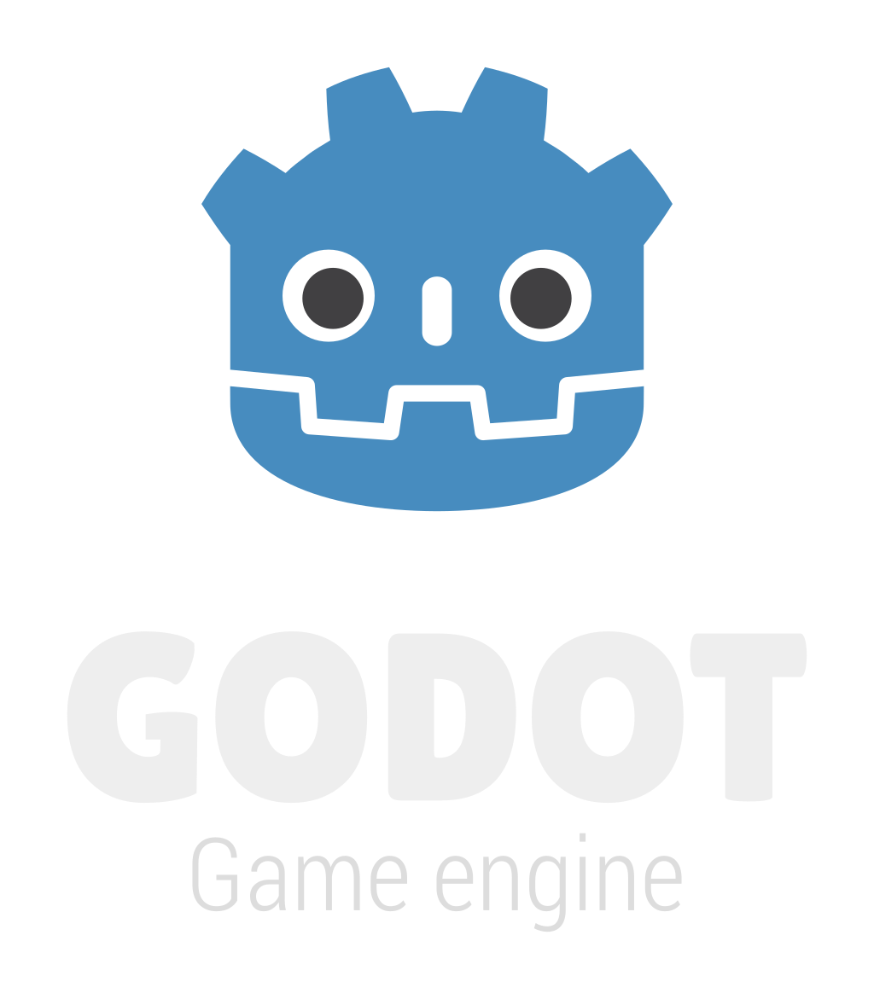

# Attribution
## Collaborators

### Hayden Koren
Asset Creation
Textures
Concepting/Planning

### Maya Ludkiewicz
2D Asset Creation 
UI 
UV Mapping

### [Tajrian Rahman](https://f1dg3t.itch.io/)  
Programming
Engine Tools

## Sourced Assets

### Falshlight
Author: [Wenedi](https://sketchfab.com/Wenedi)  
Source: [Sketchfab](https://skfb.ly/6wZpx)  
License: [CC Attribution](http://creativecommons.org/licenses/by/4.0/)

### Footstep Sounds
Author: [LoLa Joy](https://pixabay.com/users/u_xg7ssi08yr-48039129/?utm_source=link-attribution&utm_medium=referral&utm_campaign=music&utm_content=362053)  
Source: [Pixabay](https://pixabay.com/sound-effects//?utm_source=link-attribution&utm_medium=referral&utm_campaign=music&utm_content=362053)
License: [Pixbay Licence](https://pixabay.com/service/license-summary/)

### Door Sound
Author: [DRAGON-STUDIO](https://pixabay.com/users/dragon-studio-38165424/?utm_source=link-attribution&utm_medium=referral&utm_campaign=music&utm_content=382707)  
Source: [Pixabay](https://pixabay.com/sound-effects//?utm_source=link-attribution&utm_medium=referral&utm_campaign=music&utm_content=382707)
License: [Pixbay Licence](https://pixabay.com/service/license-summary/)

### Door Locked Sound
Author: [DRAGON-STUDIO](https://pixabay.com/users/dragon-studio-38165424/?utm_source=link-attribution&utm_medium=referral&utm_campaign=music&utm_content=382707)  
Source: [Pixabay](https://pixabay.com//?utm_source=link-attribution&utm_medium=referral&utm_campaign=music&utm_content=454241%22%3EPixabay)
License: [Pixbay Licence](https://pixabay.com/service/license-summary/)

### Win Sound
Author: [freesound_comunity](https://pixabay.com/users/freesound_community-46691455/?utm_source=link-attribution&utm_medium=referral&utm_campaign=music&utm_content=30759%22%3Efreesound_community)  
Source: [Pixabay](https://pixabay.com/sound-effects//?utm_source=link-attribution&utm_medium=referral&utm_campaign=music&utm_content=30759%22%3EPixabay)
License: [Pixbay Licence](https://pixabay.com/service/license-summary/)

### Loose Sound
Author: [freesound_comunity](https://pixabay.com/users/freesound_community-46691455/?utm_source=link-attribution&utm_medium=referral&utm_campaign=music&utm_content=30759%22%3Efreesound_community)  
Source: [Pixabay](https://pixabay.com/sound-effects//?utm_source=link-attribution&utm_medium=referral&utm_campaign=music&utm_content=68767%22%3EPixabay)
License: [Pixbay Licence](https://pixabay.com/service/license-summary/)

### Light Hum Sound
Author: [freesound_comunity](https://pixabay.com/users/freesound_community-46691455/?utm_source=link-attribution&utm_medium=referral&utm_campaign=music&utm_content=30759%22%3Efreesound_community)  
Source: [Pixabay](https://pixabay.com//?utm_source=link-attribution&utm_medium=referral&utm_campaign=music&utm_content=7058%22%3EPixabay)
License: [Pixbay Licence](https://pixabay.com/service/license-summary/)

### Ambient Air Sound
Author: [freesound_comunity](https://pixabay.com/users/freesound_community-46691455/?utm_source=link-attribution&utm_medium=referral&utm_campaign=music&utm_content=30759%22%3Efreesound_community)  
Source: [Pixabay](https://pixabay.com/sound-effects//?utm_source=link-attribution&utm_medium=referral&utm_campaign=music&utm_content=32396%22%3EPixabay)
License: [Pixbay Licence](https://pixabay.com/service/license-summary/)

#### Godot Engine Logo
Author: Andrea Calabró
Source: [godotengine.org : press](https://godotengine.org/press/)  
License: [CC BY 4.0 International](https://github.com/godotengine/godot/blob/master/LOGO_LICENSE.txt) 

## Tools
#### Godot
  
Author: [Juan Linietsky, Ariel Manzur, and contributors](https://godotengine.org/contact)  
Source: [godotengine.org](https://godotengine.org/)  
License: [MIT License](https://github.com/godotengine/godot/blob/master/LICENSE.txt) 

#### Godot Menus Template
  
Author: [Marek Belski and contributors](https://github.com/Maaack/Godot-Menus-Template/graphs/contributors)  
Source: [github: Godot-Menus-Template](https://github.com/Maaack/Godot-Menus-Template)  
License: [MIT License](LICENSE.txt)  

#### Git
  
Author: [Linus Torvalds](https://github.com/torvalds)  
Source: [git-scm.com](https://git-scm.com/downloads)  
License: [GNU General Public License version 2](https://opensource.org/licenses/GPL-2.0)

# Special Thanks
## Programing Debugger
5eater5 (Actually big help)
